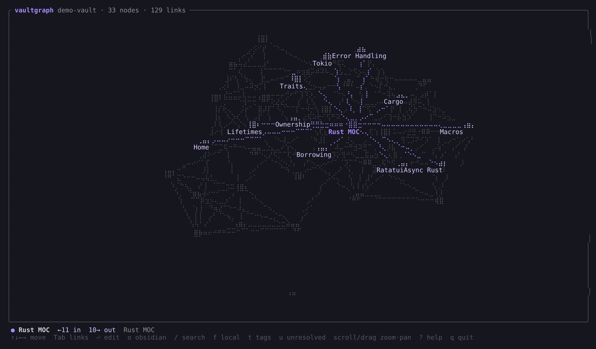

# vaultgraph

An Obsidian-style graph view for the terminal. Point it at a vault and get a live,
force-directed graph of your notes, drawn with braille characters. It works in any
truecolor terminal (Ghostty, Kitty, WezTerm, iTerm2). It doesn't need the Obsidian app.



## Install

```bash
cargo install --path .
```

## Use

```bash
vaultgraph ~/path/to/vault
```

Press `?` inside the app for every key. The essentials:

| Key | Action |
| --- | --- |
| `↑↓←→` / `hjkl` | select the nearest note in that direction |
| `Tab` / `Shift-Tab` | cycle through the selected note's links |
| `b` | back to the previous selection |
| `/` then `n` / `N` | search, then jump between matches |
| `Enter` | open in `$EDITOR` (unresolved links get created, like in Obsidian) |
| `o` | open the note in the Obsidian app (`obsidian://` URI) |
| `f`, `[` `]` | local graph around the selection, and its depth |
| `t` / `u` / `O` | toggle tag nodes / unresolved links / orphans |
| scroll, drag | zoom at cursor, pan, drag nodes around |
| `0` / `c` | fit everything / centre on selection |
| `a` | label mode: auto → all → selection only |
| `space` / `r` / `q` | pause layout / rescan vault / quit |

## What it understands

- `[[wikilinks]]`, `[[note|alias]]`, `[[note#heading]]`, `![[embeds]]`, and `[text](note.md)` links
- Obsidian-style resolution by file name, or by path when the link includes one
- Inline `#tags` and frontmatter `tags:`
- Skips code blocks, inline code, attachments (images, PDFs and so on), and hidden folders such as `.obsidian` and `.trash`

## Limits / ideas

- The layout is O(n²). Vaults with a few thousand notes are fine; for bigger ones, the next step would be Barnes–Hut.
- Rendering uses braille characters. Pixel-perfect rendering with the Kitty graphics protocol (which Ghostty supports) is a possible upgrade.
- No colour groups or file watching yet. Press `r` to rescan after you edit outside the app; edits made through `Enter` rescan automatically.
