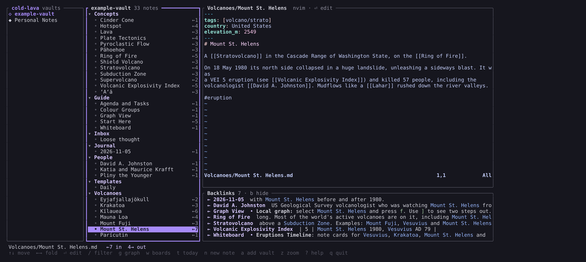
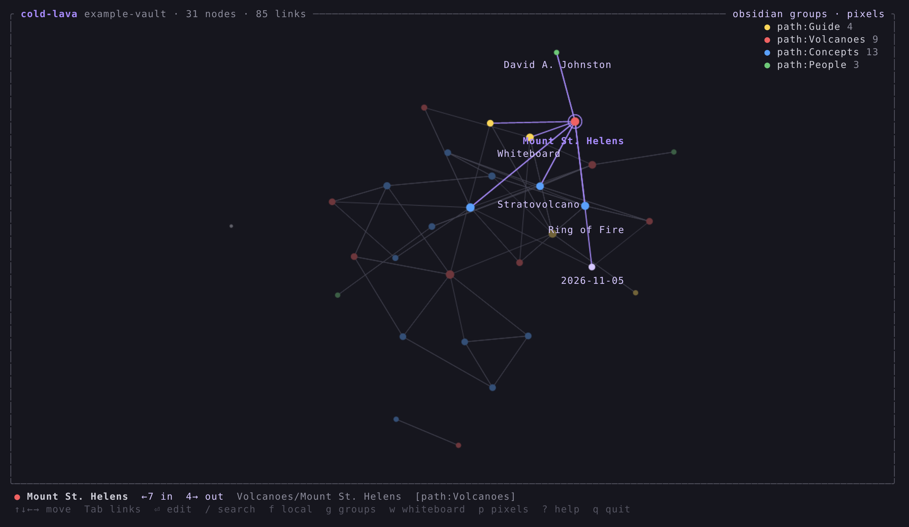
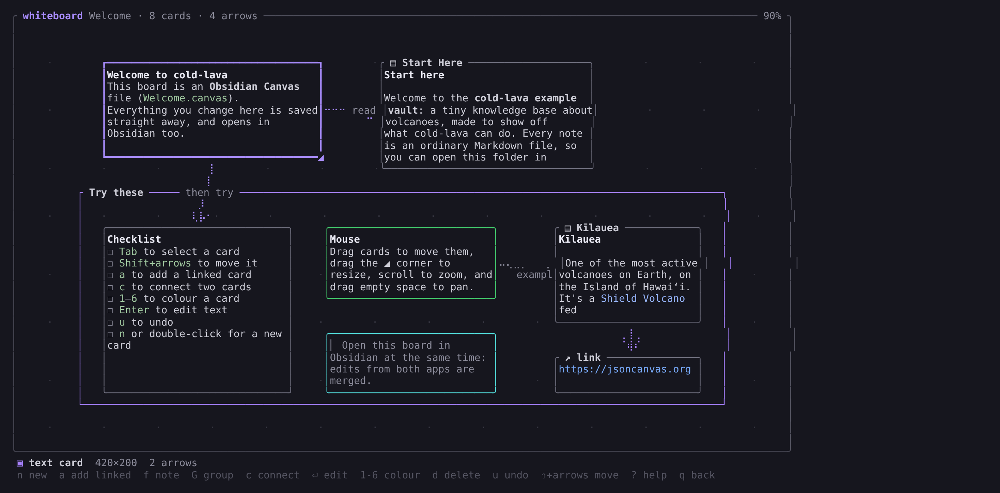
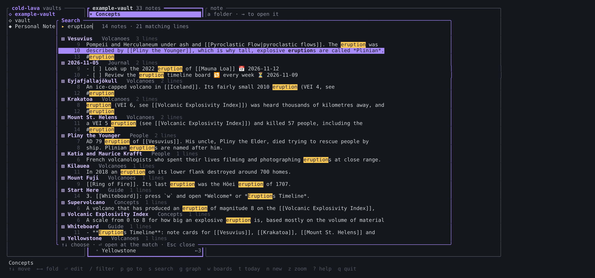

# cold-lava

[](https://github.com/AlenEngineer/cold-lava/actions/workflows/ci.yml)

Obsidian's graph view and canvas, in the terminal. You get:

- **A main menu** with all your vaults (found automatically from Obsidian) and their notes, and
  your own **Neovim embedded right there** to read and edit the selected note.
- **A live, force-directed graph** of your notes. In Ghostty, Kitty and WezTerm it's drawn as
  real anti-aliased pixels through the Kitty graphics protocol; elsewhere it uses braille characters.
- **Colour groups**, read from your vault's own Obsidian graph settings or generated by folder or tag.
- **A whiteboard** that reads and writes Obsidian Canvas (`.canvas`) files, so boards round-trip
  between the terminal and the Obsidian app.

It doesn't need the Obsidian app running, and it stays live: edit notes in your editor or in
Obsidian and the graph updates on its own.





## Install

Download a binary for Linux or macOS from the
[latest release](https://github.com/AlenEngineer/cold-lava/releases/latest), or build it:

```bash
cargo install --path crates/cold-lava
```

## Try it

The repo includes a small example vault about volcanoes, built to show every feature: folders
with Obsidian colour groups, tags, a few unresolved links, an orphan note, and two whiteboards.

```bash
git clone https://github.com/AlenEngineer/cold-lava
cd cold-lava
cargo run --release -- example-vault
```

This opens the main menu with the example vault. Start with the **Guide › Start Here** note,
press `g` for the graph, or press `w` and open the **Welcome** board for a guided tour. It's also a normal Obsidian vault: open the
`example-vault` folder in Obsidian to compare the two side by side.

## Use

```bash
cold-lava                               # main menu: all your vaults
cold-lava ~/path/to/vault               # main menu with that vault open
cold-lava graph ~/path/to/vault         # straight to the graph view
cold-lava board ~/vault/Plan.canvas     # whiteboard (created if missing)
cold-lava board ~/vault                 # pick a board
cold-lava daily ~/vault [DATE]          # open (or create) a day's daily note
cold-lava agenda ~/vault --json         # dated tasks and daily notes, for other programs
cold-lava items ~/vault task            # every task (or list, heading, block), one per line
cold-lava search ~/vault WORDS…         # full-text search
cold-lava rename ~/vault NOTE NEW       # rename or move a note, updating every link to it
cold-lava task toggle FILE:LINE         # tick / untick a task
cold-lava types ~/vault                 # the vault's types, and what's wrong with them
```

Flags: `--pixels` / `--braille` to force a renderer. Pixel mode is on automatically in Ghostty,
Kitty and WezTerm, but not inside tmux or Zellij, which don't pass the protocol through.

Press `?` in any view to see every key.

### Main menu

Three columns: **vaults**, the selected vault's **notes** (a folder tree, with whiteboards), and
the selected **note**, in the reader or in Neovim. Vaults come from Obsidian's own vault list, the vaults you've
opened in cold-lava, and any folder you add with `a`.

The right pane runs your real Neovim (your config, colours and plugins). It follows the
selection as you move through notes; press `Enter` to start editing and `Ctrl-q` to get back to
the menu. Press `v` to switch the pane to the **reader** and back.

**The reader** shows the note rendered, in the vault's [Markdown flavour](#markdown-flavour):
headings, lists and tasks, quotes and callouts (folded ones show only their title), code blocks,
tables, highlights, tags, and embeds as placeholders. Frontmatter is hidden. Links are
underlined, dimmer when the note doesn't exist yet. Without Neovim or Vim the pane is always the
reader, and `Enter` on a note goes into it. In the reader, `Tab` selects the next link and
`Enter` follows it, exactly like `Enter` on a link in Neovim (URLs open in the browser); a click
on a link follows it too. `e` edits the note in `$EDITOR` full screen, and `Esc` goes back to
the notes. The reader updates when the note changes on disk and keeps its place.

**Links and backlinks.** Inside Neovim, press `Enter` (or `gf`) on a `[[link]]` or
`[text](note.md)` to open that note, resolved the way Obsidian does. `[[Note#Heading]]` and
`[[Note#^block]]` jump to the heading or block. A link to a note that doesn't exist yet creates
it, in the folder Obsidian's "Default location for new notes" setting says. `Ctrl-o` goes back,
since it's Neovim's own jump list. Under the editor, **Backlinks** lists every note that links to
the open one, with the line it's on. `Tab` into it and press `Enter` to open that note at the
link, or press `b` to hide it. Edits are saved when you move to another note or quit. cold-lava uses `$VISUAL` or
`$EDITOR` if it's Neovim or Vim (`$COLD_LAVA_EDITOR` comes first), otherwise `nvim` from your
`PATH`. Without either, or with `COLD_LAVA_EDITOR=none`, the pane shows the reader.

| Key | Action |
| --- | --- |
| `↑↓` / `jk`, `Tab` | move; switch between vaults, notes and the editor or reader |
| `→` / `←` | open / close a folder |
| `Enter` | edit the note in Neovim, or read it in the reader · open a whiteboard |
| `v` | switch the pane between the reader and Neovim |
| `Ctrl-q` | leave Neovim, back to the menu (`pane.leave`) |
| `Enter` in Neovim, `Ctrl-o` | follow the `[[link]]` under the cursor · go back |
| `b` | show / hide backlinks |
| `p` (or `Ctrl-o`) | quick switcher: jump to any note by name or alias |
| `:` | command palette: run any command by name (its key is shown next to it) |
| `s` (or `Ctrl-f`) | search the text of every note |
| `R` / `m` | rename / move the note, updating every link to it (with a preview first) |
| `/` | filter notes (accents ignored: `kil` finds Kīlauea) |
| `g` / `w` | graph / whiteboards for this vault (`q` comes back) |
| `n` / `a` | new note in the selected folder / add a vault |
| `z`, `e`, `o` | zoom the editor · edit in `$EDITOR` full screen · open in Obsidian |

If Neovim gets into a bad state, or you changed its config, run `nvim.restart` from the
palette. It saves every note, quits Neovim, and starts it again on the same note.

In the reader:

| Key | Action |
| --- | --- |
| `j` / `k`, `↑↓` | scroll |
| `space` / `PageDown` / `Ctrl-d`, `PageUp` / `Ctrl-u` | page down, page up |
| `g` / `Home`, `G` / `End` | top, bottom |
| `Tab` / `Shift-Tab` | select the next / previous link |
| `Enter` | follow the selected link (creates missing notes) |
| `e` | edit the note in `$EDITOR` full screen |
| `Esc` / `q` | back to the notes |

Other menu keys (`p`, `s`, `:`, `?`, `R`, ...) work in the reader too.

### Graph view

| Key | Action |
| --- | --- |
| `↑↓←→` / `hjkl` | select the nearest note in that direction |
| `Tab` / `Shift-Tab`, `b` | cycle through the selected note's links / go back |
| `/` then `n` / `N` | search, then jump between matches |
| `Enter` | open in `$EDITOR` (unresolved links get created, like in Obsidian) |
| `o` | open the note in the Obsidian app |
| `f`, `[` `]` | local graph around the selection, and its depth |
| `g` | colour groups: Obsidian's → by folder → by tag → off |
| `p` | switch between pixels and braille |
| `w` | whiteboards |
| `t` / `u` / `O` | toggle tag nodes / unresolved links / orphans |
| scroll, drag | zoom at the cursor, pan, drag nodes |
| `0` / `c` / `a` | fit / centre on selection / label mode |
| `space` / `r` / `q` | pause layout / rescan / quit |

### Whiteboard

| Key | Action |
| --- | --- |
| `n`, double-click | new text card |
| `a` | new card with an arrow from the selected one (mind-map style) |
| `f` | add a vault note as a card (shows a live preview) |
| `G` | group (around the selection); groups carry their contents when moved |
| `c` | draw an arrow: pick the target, `Enter` (doing it again removes the arrow) |
| `Enter` / `E` | edit inline / edit in `$EDITOR` (note cards open the note) |
| `Shift+arrows`, drag | move · `Ctrl+arrows`, `[ ] { }`, drag `◢` to resize |
| `1`–`6` / `0` | Obsidian colour presets / clear |
| `d`, `u` / `U` | delete, undo / redo |
| `o` | open the note, or the board itself, in Obsidian |

Every change saves straight to the `.canvas` file. Fields that cold-lava doesn't use are
kept as they are, so Obsidian data and plugin data survive a round trip.

**Safe to use alongside Obsidian.** If the same board is open in both and changes on disk,
cold-lava merges instead of overwriting: cards and arrows are matched by id and merged field
by field. If Obsidian moves a card while you edit its text, both changes are kept. If the same
field changed in both places, your cold-lava version wins and you get a notice. A card deleted
on one side but edited on the other is kept.

**Quick switcher and search.** `p` opens the quick switcher: type a few letters of a note's
name or one of its `aliases` (in order is enough: `msh` finds Mount St. Helens), `Enter` opens
it, and a name that doesn't exist yet can be created. `s` searches the text of every note: all
the words must appear in a note, `"quotes"` keep a phrase together, case and accents are ignored
(`hawaii` finds Hawaiʻi), and `Enter` opens the note at the matching line. From inside Neovim,
`:ColdLavaSwitcher` and `:ColdLavaSearch words` open them too; map them to keys you like, e.g.
`nnoremap <C-p> <Cmd>ColdLavaSwitcher<CR>`.



Scripts can search as well:

```bash
cold-lava search ~/vault volcanic winter          # file:line: text
cold-lava search ~/vault '"ash cloud"' --json      # with match positions, for highlighting
```

### Keys

Every command has an id (`graph.open`, `note.switch`, `board.undo`, ...), and its keys can be
changed in `~/.config/cold-lava/config.toml` (or `$XDG_CONFIG_HOME/cold-lava/config.toml`):

```toml
[keys]
"graph.open"  = "G"              # replaces that command's default keys
"note.switch" = ["p", "ctrl+p"]  # several
"vault.add"   = []               # unbound
```

Keys are written like `g`, `G`, `ctrl+o`, `alt+x`, `shift+tab`, `esc`, `enter`, `space`,
`backspace`, `delete`, `up`, `down`, `left`, `right`, `pageup`, `pagedown`, `home`, `end`. The help screens (`?`) and the command palette show the keys you set.
`cold-lava keys` lists every command with its keys and reports mistakes in the file. A mistake
never stops the app: an unknown id or a key that doesn't parse is skipped, and when two commands
on the same screen would share a key, both keep their default keys.

Extensions add commands to the menu, and they work the same way. Neovim's `nvim.restart` has no
key until you give it one, for example `"nvim.restart" = "ctrl+r"`.

While Neovim has focus it gets every key except `pane.leave` (`Ctrl-q`), which takes you back to
the menu. Move it if you use `Ctrl-q` in Neovim, for example `"pane.leave" = "ctrl+g"`. It can't
be `[]`, so there is always a way out.

### Markdown flavour

Notes are read as `obsidian` Markdown when the vault has an `.obsidian` folder and as `github`
Markdown otherwise. The same file can choose a flavour, or define one from a built-in
(`commonmark`, `github`, `obsidian`) with syntax added or removed:

```toml
[markdown]
flavour = "mine"                    # optional

[markdown.flavours.mine]
base = "github"                     # default: commonmark
add = ["wikilinks", "highlights"]
remove = ["footnotes"]
```

The syntax names are `tables`, `task-lists`, `strikethrough`, `footnotes`, `alerts` (GitHub's
`> [!NOTE]`), `wikilinks`, `embeds`, `callouts`, `highlights`, `comments`, `tags`, `block-ids`,
`math` and `frontmatter`. Mistakes are reported by `cold-lava keys` and fall back to the
default.

### Renaming and moving notes

```bash
cold-lava rename ~/vault "Mount St. Helens" "Mount Saint Helens" --dry-run   # show what would change
cold-lava rename ~/vault Lava Geology/                                      # move, keeping the name
cold-lava rename ~/vault Lava "Geology/Hot Rock"                            # move and rename
```

In the main menu, press `R` to rename the selected note or `m` to move it to another folder:
you see every link that will change before confirming.

Every link to the note is updated, the way Obsidian does it: `[[wikilinks]]` with their
aliases, headings and embeds, Markdown links (relative or vault paths), links in frontmatter,
and whiteboard note cards and text cards. Each link keeps its style: a short `[[Name]]` stays
short unless another note has the same name, `[[Folder/Name]]` keeps its path, and relative
Markdown links are recomputed. When a note moves folder, its own relative links are fixed too.
Code is never touched. If any file changes between the plan and writing it, nothing is changed.

### Agenda, daily notes and tasks (for scripts and status bars)

Other programs (a status bar's calendar, a widget, a script) can ask cold-lava about tasks
instead of parsing the vault themselves. Tasks use the **Obsidian Tasks** format, emoji
(`- [ ] Pay rent 📅 2026-11-07 🔁 every month`) or Dataview (`[due:: 2026-11-07]`), and the
plugin's global filter. Daily notes follow the vault's **Daily notes** settings (folder,
date format, template).

```bash
cold-lava agenda ~/vault --from 2026-11-01 --to 2026-11-30 --json
```

The JSON has `tasks` (text, status, dates, recurrence, priority, tags, `file`/`path`/`line`, and an
`id`), `daily_notes` (date and path), and `days`, a per-day summary (`tasks`, `open`,
`daily_note`) for calendar markers. A task's `date` is its due date, else scheduled, else start;
a task in a daily note with no date of its own belongs to that note's day (`date_source` says
which). A few thousand notes take well under a second.

```bash
cold-lava daily ~/vault 2026-11-07            # open that day's note in the menu (created from the template)
cold-lava daily ~/vault today --path          # create if needed, print the path, no UI
cold-lava task toggle ~/vault/Bills.md:12 --id 3f2a9c81b7d0 --json
```

Every task, list item, heading and block with a `^id` is an **item**, and `cold-lava items` lists
the items of one kind:

```bash
cold-lava items ~/vault task                  # Journal/2026-11-05.md:9  [ ] Look up … due 2026-11-12
cold-lava items ~/vault heading --json        # one JSON object per line
```

Each item has an `id` that stays the same when a task is ticked, re-dated, re-indented or moved
down by lines added above it (an author's `^block-id` keeps it even when the words change), the
`section` (headings) it sits under, its `parent` list item, and a `rev` that changes whenever its
lines do. Items are read in the vault's Markdown flavour: tasks in callouts count, tasks in code
blocks and `%%comments%%` don't, and custom statuses follow the Tasks plugin's settings.

`task toggle` works like Obsidian Tasks: it adds the done date (`✅`, or `[completion:: …]`),
removes it when unticking, and for recurring tasks inserts the next occurrence with its dates
moved forward. Pass the `id` from the agenda: if the line has changed since, nothing is touched
and the exit code is **3**, so the caller can refresh. In the main menu, `t` opens today's note.

### Types

A **type** says what some of your notes or blocks mean: a `volcano` is a note tagged
`#volcano`, with `country` and `elevation` read from its frontmatter; an `eruption` is a row of
any table whose header has `VEI` and `Example`. Types are written in TOML, with no code: the
fields and their value types (text, number, date, datetime, bool, link, tag, enum, duration),
where each field is read (a table column, a frontmatter property, a `📅` marker, a Dataview
`due::` field, a pattern's group, …), and how it looks.

Put them in `.cold-lava/types.toml` in the vault (it travels with the vault, and Obsidian ignores
it), or under `[types.NAME]` in `~/.config/cold-lava/config.toml` for every vault. The vault's
file starts with `version = 1`. The example vault has two:

```toml
version = 1

[types.volcano]
on = "note"
where.tag = ["volcano"]
fields.country = { property = "country" }
fields.elevation = { property = "elevation_m", type = "number" }
```

`cold-lava types ~/vault` lists every type: where it comes from, the shapes it is read from, each
field with its value type, where it's read and whether cold-lava could write it back, and its
looks. Mistakes are listed one per line with the file and the type; the broken type is left out,
the rest load, and the exit code is 1. `--json` prints the same as JSON. For now types are only
loaded and checked: finding them in notes comes next. The full design is in
[docs/extensions.md](docs/extensions.md#types).

## What it understands

- `[[wikilinks]]` (with aliases, headings and embeds), and `[text](note.md)` links
- Obsidian-style link resolution, `#tags` and frontmatter `tags:`
- It skips code blocks, attachments and hidden folders
- Colour-group queries: `path:`, `file:`, `tag:#…`, plain words, `-negation`, `"quotes"`, `OR`

## Limits

- The layout is O(n²): vaults of a few thousand notes are fine; for more, the next step would be Barnes–Hut.
- Whiteboard: no freehand drawing, because JSON Canvas has no freehand shapes. Edge labels
  display but can't be edited yet. Excalidraw drawings aren't rendered.

## Development

How it fits together: [docs/engine.md](docs/engine.md) (the engine, its layers and the
frontends) and [docs/extensions.md](docs/extensions.md) (the extension protocol and plans).

The engine (`crates/engine`, no user interface), the terminal UI (`crates/cold-lava`) and the
frontend framework (`crates/views`, filled as its parts are extracted) are crates in one Cargo
workspace. A graphical window on Tauri lives in `crates/gui`, outside the workspace so normal
builds never compile a webview: `cargo run --manifest-path crates/gui/Cargo.toml` (on Linux it
needs webkit2gtk-4.1). The terminal UI is and stays the main way to use cold-lava.

```bash
cargo test --workspace                                   # unit and integration tests
cargo clippy --workspace --all-targets -- -D warnings    # lints, as in CI
cargo fmt --all --check
```

### Scripting and testing the UI

`cold-lava drive` runs cold-lava in a hidden terminal and follows a script, one step per line:

```bash
cold-lava drive crates/cold-lava/tests/drive/follow-link.drive -- example-vault
```

```
# Notes open in the reader, not Neovim.
env COLD_LAVA_EDITOR=none
wait-for example-vault
# Each token is a key name (enter, tab, ctrl+q, …) or text.
keys p kilau enter
# Waits up to 5 s; `wait-for 10s TEXT` waits longer.
wait-for Kīlauea  reading
expect One of the most active volcanoes
# Print the screen.
screen
keys q q
exits 0
```

`#` starts a comment only at the beginning of a line. A failing step prints `SCRIPT:LINE:` and what it expected, then the screen, and exits 1.
`cold-lava --help` lists every step. Without a SCRIPT, the script is read from stdin.
The program runs with an empty home folder, so your `config.toml`, your Neovim config and your
list of vaults stay out of it; `cold-lava drive --real-home` uses yours.

## Versions and releases

cold-lava uses [semantic versioning](https://semver.org). Before 1.0, a minor version (0.**2**.0)
may change commands, keys or file formats; a patch version (0.1.**1**) only fixes things. Every
release is listed in [CHANGELOG.md](CHANGELOG.md), and `cold-lava --version` prints yours.

Releases are automatic. To cut one, open a PR that:

1. sets `version = "x.y.z"` under `[workspace.package]` in `Cargo.toml` (then `cargo build` to
   update `Cargo.lock`), and
2. moves the changes under `## [Unreleased]` in `CHANGELOG.md` into a new
   `## [x.y.z] - YYYY-MM-DD` section.

CI checks it with [`scripts/release-check.sh`](scripts/release-check.sh) (you can run it
locally too): a new version needs its changelog section and must be higher than the last
release. Once the PR is merged into `main`, the [release workflow](.github/workflows/release.yml)
runs the tests, builds Linux and macOS binaries (x86-64 and ARM), creates the `vx.y.z` tag and
publishes the GitHub Release, with that changelog section as its notes. Pushing a `vx.y.z` tag
by hand does the same.

## License

MIT, see [LICENSE](LICENSE).
